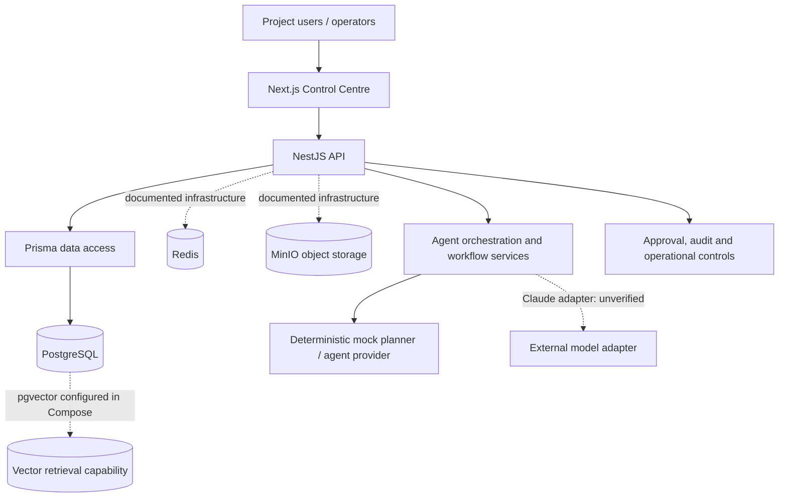

# Leadma AI Workforce — Architecture Overview

This diagram is a portfolio-level view derived from the components and infrastructure named in the private repository documentation. It is not a substitute for the full internal architecture or deployment topology.

## Documented technology components

- **Web Control Centre:** Next.js
- **API:** NestJS
- **Application/data access:** TypeScript and Prisma
- **Primary data store:** PostgreSQL
- **Vector capability:** PostgreSQL with pgvector is described in Docker Compose
- **Supporting infrastructure:** Redis and MinIO are described in Docker Compose
- **Agent provider status:** the UAT report identifies deterministic mock planner/agent implementations; the Claude adapter is unverified.

## Component view

Dashed relationships indicate infrastructure or integration points described in repository documentation, not independently verified live integrations.

## Important implementation qualifications

The repository's UAT report records 130 automated tests across five suites. It also states that:
- Agent planning and execution use deterministic mock implementations.
- The Claude adapter is unverified.
- External GitHub/CI integration is not implemented.
- A release is recorded by the platform; it is not a deployment to infrastructure.
- Containers had not been built at the time of the report.
- External penetration testing, DAST, dependency audit, separate-infrastructure disaster recovery and realistic-scale load/soak testing were not completed.

For this reason, this portfolio describes the system as an enterprise-oriented Agentic AI platform implementation under development—not as a production-validated autonomous workforce.

## Source

Private implementation repository: https://github.com/akjayakody/Leadma_AI_Agents
