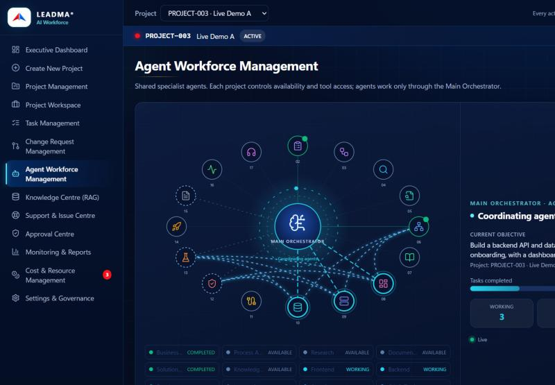
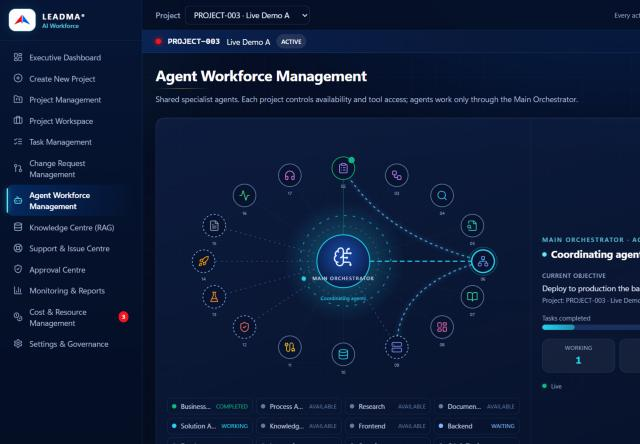
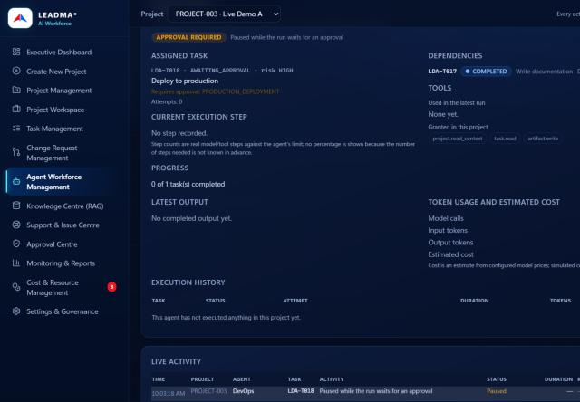
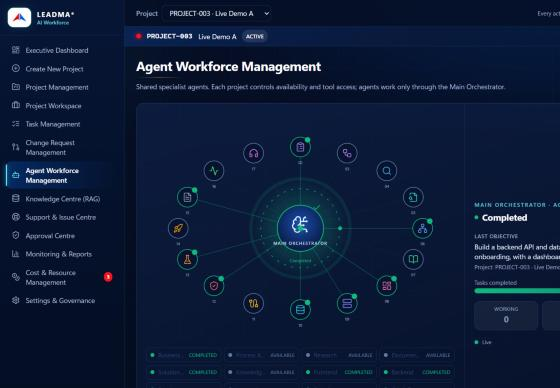
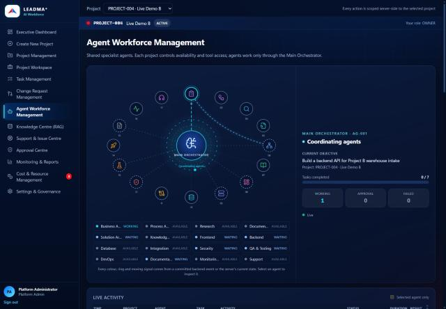
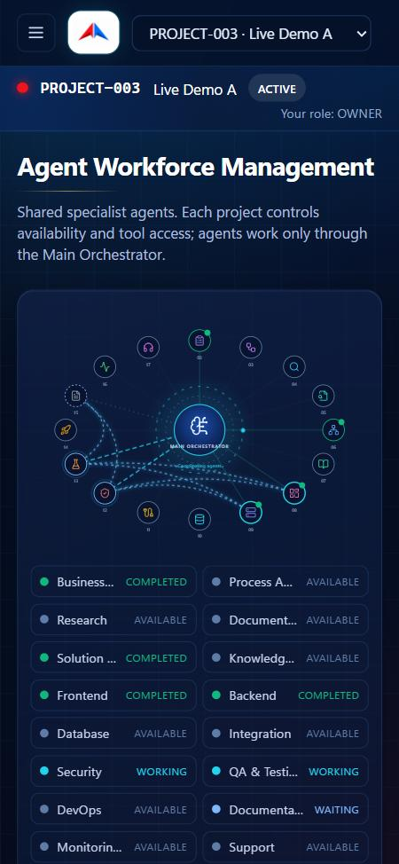

# Leadma AI Workforce — Application Screenshots

These screenshots were selected from the private Leadma AI Workforce repository's live-command-centre evidence folder and reviewed before publication. They show interface states and workflow controls; they are not independent proof of production deployment or external model-provider integration.

## 1. Agent Workforce Command Centre

The dashboard presents the Main Orchestrator and the availability/status of specialist agents.

## 2. Dependency-aware workflow

Shows a workflow state in which an agent is waiting on a dependency.

## 3. Human approval gate

The task detail shows an approval-required state and explicitly indicates that execution has not occurred. This illustrates a human-in-the-loop control.

## 4. Completed orchestration state

Shows the completed state and specialist-agent status indicators.

## 5. Project context selection

Shows Project B selected in the workspace. The repository's UAT documentation separately describes project-isolation tests; this screenshot alone should not be treated as a security certification.

## 6. Mobile-width interface

A mobile-width view of the Agent Workforce Management screen.

## Publication and evidence notes

- These images contain demo project labels and workflow data, not identified client records.
- No credentials, API keys or real customer personal information were visible in the selected images during review.
- The screenshots were copied from the private repository's `docs/evidence/live-command-centre/` folder.
- The UAT report records deterministic mock planner/agent implementations and says the Claude adapter is unverified. These visuals therefore demonstrate UI and workflow states, not verified autonomous execution by an external AI model.
- The UAT report also records that release is logged by the platform rather than deployed to infrastructure. Do not present these screenshots as proof of production deployment.
